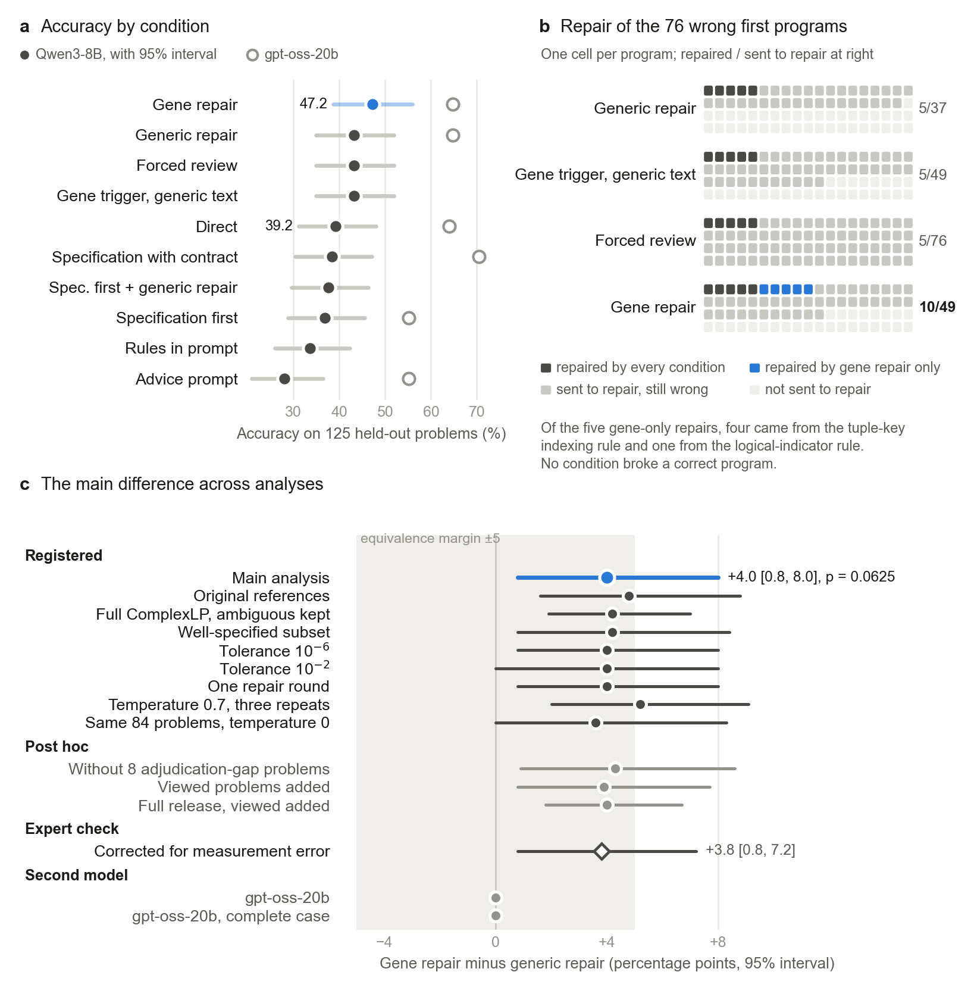

<p align="center">
  
</p>

<h1 align="center">Expert Preference Genes</h1>

<p align="center">
  <b>Review rules that read the optimization model a language model just wrote,<br>before anyone trusts the number it prints.</b>
</p>

<p align="center">
  
  <a href="https://doi.org/10.17605/OSF.IO/CYFSP"></a>
  
  
</p>

Code, data and every raw output of the article

> Yuxin Zhang and Qi Deng. Expert Preference Genes for Optimization-Model Specification in Engineering Decision Support: Versioned Executable Review Rules for Language-Model Formulation of Mixed-Integer Programs. *Engineering Applications of Artificial Intelligence*, 2026, in press.

## The problem, in one breath

A solver never complains about a wrong model. Leave out a constraint and it still hands you an answer, with six confident decimals. Language models now write these models for people, so somebody has to read the model before the number is believed.

An experienced modeler reads it with a list of habits in mind: do the indices match, is every big-M tied to the data, is anything nonlinear hiding in a Python `if`. We wrote 21 of those habits down as small records we call **expert preference genes**. Each one has a scope, a check a computer can run, a repair instruction, and a note on where it came from. The checks read the program; when one fails, its finding goes back to the language model, at most twice.

Then we froze everything, registered it, and ran a test we had not seen.

## What the test said

| On 125 held-out problems, an 8-billion-parameter open model | solved |
|---|---|
| wrote the program once | 39.2% |
| was told "your program failed, fix it" (generic repair) | 43.2% |
| was told what the rules found (gene repair) | **47.2%** |

- **Gene repair beat writing once** by 8.0 points (adjusted p = 0.006).
- **Gene repair against generic repair: +4.0 points, five problems gained, none lost, p = 0.0625.** By the rule we registered before the test, that is not a win, and the article says so. We are not going to round 0.0625 down for a README.
- **The rules were right about what is wrong.** They sent 49 programs to repair, and all 49 were wrong. Repair then fixed ten of them. Finding the fault is the strong half; getting the model to fix it is the weak half.
- A second, larger model showed no difference between the two repairs. Nothing solved any of the eight engineering-source instances.
- Two independent experts judged 68 of the programs blind, to check that "the solver agrees with the reference" means what we use it for: 2.5% false positives, 10.0% false negatives.

<p align="center">
  
</p>

## Try it in two minutes

```bash
git clone https://github.com/JAM-LUIS/expert-preference-genes-evaluation.git
cd expert-preference-genes-evaluation
python -m venv .venv && source .venv/bin/activate
pip install -r requirements.txt        # one package: PuLP, which brings the CBC solver (Python 3.10+)
```

**1. Recompute the headline numbers from the raw outputs.** Standard library only; it reads the stored results of the test, applies the frozen analysis set, and stops with an error if anything differs from the article.

```bash
python quickstart/reproduce_results.py
```

```text
Main analysis set: 125 held-out problems   [ok]

Condition             correct  accuracy  article
Gene repair            59/125     47.2%    47.2%   [ok]
Generic repair         54/125     43.2%    43.2%   [ok]
Direct generation      49/125     39.2%    39.2%   [ok]

Gene repair vs generic repair: 5 gained, 0 lost, difference +4.0 points, exact McNemar p = 0.0625   [ok, ok, ok, ok]
```

**2. Let the rules read a program.** The example is a small shipping problem (blueberry jam, two kitchens, three shops) and a program that reads its variables with the wrong kind of key, the fault behind four of the five problems that only gene repair fixed.

```bash
python quickstart/check_program.py --example
```

```text
Rules active for this problem: 15 of the 16 that gene repair uses
Program ran: no
Checks passed: 12   failed: 3   warnings: 0

FAILED  orgene.code.tuple_key_indexing
  Rule:  A mapping whose keys are tuples must be read with a tuple key, d[i, j]; d[i][j] looks up d[i] and fails.
  Found: tuple-keyed mapping(s) x are indexed as d[i][j]; their keys are tuples, so write d[i, j]
  Fix:   Index the flagged mapping with a tuple key, d[i, j], everywhere it is read, ...
```

Now your own: `python quickstart/check_program.py --problem my_problem.txt --program my_model.py`. The program has to use PuLP and print a `STATUS:` and a `FINAL_OBJECTIVE:` line, as in the example. The last block of the output is the message the evaluation would have sent back to the model, ready to paste into a chat.

**3. Score your own run of MAMO ComplexLP or IndustryOR with the checked references.** Give it a two-column CSV (problem id, the objective your method returned).

```bash
python quickstart/score_with_checked_references.py --benchmark industryor --answers my_answers.csv
```

It prints your accuracy against the original references and against the checked ones, and names the problems where the verdict on your answer changes.

If you want to see that step 2 is the real thing and not a demo: `python quickstart/replay_stored_checks.py` runs the checks again on programs stored during the test and compares active rules, failed rules and repair message with the stored records. (It executes model-written programs; a virtual environment is the least you owe yourself.)

Steps 1 and 3 need no package at all and also run on Python 3.9. Step 2 uses PuLP 3.3.2, the version of the evaluation. Tested on macOS: steps 1 and 3 with Python 3.9 and 3.14, step 2 with Python 3.14.

## Where to look

| You want | Go to |
|---|---|
| The 21 rules, readable | [`RULES.md`](RULES.md) (the registered file is `frozen_tree/genes/genes.it1.jsonl`) |
| The code that runs the checks and the repairs | `frozen_tree/runtime/`, prompts in `frozen_tree/conditions/` |
| Checked reference answers of the two benchmarks | [`references/checked_references.csv`](references/checked_references.csv) |
| Two independent models for each of 125 benchmark problems | [`rederivations/`](rederivations/) |
| The problem ids of each analysis set | `frozen_tree/data/splits_r1/` |
| Every request, response and score of the held-out test | `outputs/test-main-20261006/` |
| The numbers of Section 6 | `analysis/` |
| What two experts made of 68 programs | `measurement_check/` |

## The benchmark references, checked

MAMO ComplexLP and IndustryOR are what this field measures itself with, and both contain reference answers that are wrong or that rest on a statement with more than one reading. Before the test, two batches of isolated agents recomputed the references of 125 problems without access to the reference answers, and a co-author who wrote none of the rules adjudicated the disagreements (Section 4.2 of the article).

The verdicts are in [`references/checked_references.csv`](references/checked_references.csv): problem id, original value, verdict (`CORRECT`, `INCORRECT` or `AMBIGUOUS`), corrected value where there is one, and how the verdict was reached. A problem that is not in the table keeps its original reference. The number in an id such as `industryor-0001` is the `id` field of the source file, at the revision named in `LICENSES.md`. Step 3 above applies the table for you; the scoring rule itself is in `frozen_tree/runtime/orgene/refs.py`.

If you evaluate on these benchmarks, take the table. It is free, and it will stop you from being marked wrong by a wrong answer key.

## What is in the jar

| Folder | Content |
|---|---|
| `frozen_tree/` | The code and data tree exactly as frozen for the held-out evaluation (freeze manifest 5, `frozen_tree/FREEZE_MANIFEST.json`): the rule library and lexicon (`genes/`), predicate and runtime code (`runtime/`), prompts and templates (`conditions/`), configuration, unit matrices and scheduler plans (`configs/`), split and subset files, adjudicated references with their verdicts and the type labels (`data/`), scoring and analysis code (`analysis/`, `tools/`), and the preregistration text (`prereg/`). Some working notes in the tree are in Chinese. |
| `outputs/` | Raw outputs of every unit: requests, responses, execution records, predicate results, repair messages, token counts, and the scored result files. One archive per stage, so the two benchmarks are never packed together. `test-main-20261006/` is the formal held-out run (4,000 units), `test-viewed0905-20261010/` the supplementary post hoc run, `rehearsal-dev-20261005d/` the rehearsal, and the three `dev-*` folders the development runs behind Section 5. `run_registry.json` maps analysis labels to run directories. |
| `analysis/` | Output of the analysis scripts on the held-out run: paired comparisons, Holm families, equivalence tests, mechanism decomposition, strata, length model, descriptive statistics and the post hoc joins. Every number in Section 6 comes from these files. |
| `post_unsealing_tools/` | Scripts written after the scores were unsealed and kept outside the frozen tree (the manuscript says where each is used). |
| `registrations/` | The text of the seven time-stamped registration records, the five freeze manifests, the registered preregistration and the measurement-check plan. |
| `reference_check/` | Scripts and summaries of the blind recomputation of 125 benchmark references and its adjudication, including the four dated departures from the registered procedure. Counts and identifiers only. |
| `quickstart/` | Four small scripts and one example: recompute the headline numbers, let the rules read your program, score your results with the checked references, replay stored checks. |
| `RULES.md` | The 21 rules as a table you can read without parsing JSON. |
| `references/checked_references.csv` | Every checked reference of the two benchmarks: original value, verdict, corrected value. Ids and numbers only. |
| `rederivations/` | The two blind recomputations of 125 references (the models the agents wrote, their outputs, the comparison). See `rederivations/README.md`. |
| `measurement_check/` | The expert check of the solver-based measure (Sections 4.6 and 6.5): the blinded booklet of 68 sampled programs, the key, the two returned judgment workbooks, the assignment rules and the analysis output. Reviewers are identified by number only. See `measurement_check/README.md`. |
| `figures/` | Figure 2 of the article and the script that draws it. |

Fair warning: the frozen tree is the working tree exactly as it was frozen, so some of its notes are in Chinese and none of it was tidied for visitors. That is the point of freezing. `quickstart/` and this page are the tidy part.

## Receipts

Seven registrations on the Open Science Framework fix what was decided when. Each holds SHA-256 digests of the files it fixes; the texts are in `registrations/`.

| Record | Content |
|---|---|
| <https://osf.io/x5tqc/> | Frozen rule library and the comparison rules of the reference check |
| <https://osf.io/kafzj/> | Blind recomputations and the adjudication package |
| <https://osf.io/8rkf7/> | Preregistration, measurement-check plan, first freeze manifest |
| <https://osf.io/9qux6/>, <https://osf.io/wcdn6/> | Two superseding manifests |
| <https://osf.io/y9x3u/> | Adjudication, type labels, four deviations and the unsealing tools, registered before any test score was computed |
| <https://osf.io/ks8ye/> | Supplementary run of the nine test problems viewed on 5 September, registered after unsealing |

## Checking the hashes yourself

- `frozen_tree/FREEZE_MANIFEST.json` lists every frozen file with its SHA-256, which can be recomputed with `shasum -a 256`. The manifest's content digest is the one named in registration record 7 (`registrations/`).
- Each run folder holds `OUTPUT_SHA256.txt`, written by the driver when the run ended. After unpacking the stage archives into the run folder, `shasum -a 256 -c OUTPUT_SHA256.txt` checks the raw outputs. For the formal run, the five `freeze_gate.jsonl` logs differ because scoring appended its gate records, and scored result files and derived directories (`*.server_refused`, `*.final_t600`) were added by scoring; the 4,158 model-output files match. In the rehearsal, a home-directory path was replaced by `<home>` in two `schedule_inputs.json` files.
- The commands that produced `analysis/` are in `post_unsealing_tools/unseal_run.sh`; they expect the run folders unpacked under `frozen_tree/experiments/` with their original names, and the paths in the script are those of the original working tree.
- The five scripts under `reference_check/` that were redacted for double-anonymized review are the registered files again (`reference_check/REDACTIONS.md`), and the files in `rederivations/` carry the digests of record 2.

## Running the model calls again

Every number above comes from stored outputs, so nothing here needs a GPU. To generate new outputs you need [Ollama](https://ollama.com) with the two open-weight models at the digests recorded in `frozen_tree/configs/model_registry.json`. The driver is `frozen_tree/tools/run_campaign.py` and the specification of the held-out run is `frozen_tree/configs/campaigns/test_main_20261006.json`. This path is the one we ran, and it is not polished: it refuses to start on anything that is not frozen and registered, which is what it was built to do.

## What this is not

- The rules check what can be written as a program. A missing constraint that leaves the model feasible walks straight past them.
- The rules were selected and encoded by the authors. Eleven restate principles documented elsewhere; ten have no source beyond us and the development failures. No independent panel wrote them.
- The evidence is two public benchmarks of modest text problems and eight engineering-source instances. It is not deployment.
- Both benchmarks have been public since 2024, so the models may have seen the problems. "Held-out" here means the rules never saw the test problems.

Section 9 of the article has the full list.

## Not included

- The adjudicator's sheet from the reference check; the resulting references and verdicts are in `frozen_tree/data/reference_overrides/`.
- The names of the experts who judged or were invited to judge the measurement check. One of the two judges is named in the acknowledgements of the article; the other asked to remain anonymous.
- Credentials, hosts and model weights.
- The preliminary pilot of the original submission, which is documented in the supplementary material of the article.

## How to cite

```bibtex
@article{zhang2026genes,
  author  = {Zhang, Yuxin and Deng, Qi},
  title   = {Expert Preference Genes for Optimization-Model Specification in Engineering Decision Support: Versioned Executable Review Rules for Language-Model Formulation of Mixed-Integer Programs},
  journal = {Engineering Applications of Artificial Intelligence},
  year    = {2026},
  note    = {In press}
}
```

`CITATION.cff` carries the same record, and the archived copy of these materials has the DOI [10.17605/OSF.IO/CYFSP](https://doi.org/10.17605/OSF.IO/CYFSP). Found a mistake, or a rule that fires when it should not? Open an issue. A false alarm with a small program attached is the most useful thing you can send.

## Who made this

Yuxin Zhang (Rochester Institute of Technology and JAM Studio) and Qi Deng (Southwest Jiaotong University Hope College). The software evaluated here was built at JAM Studio, which the first author owns; the article's declaration of competing interest says the same. The logo is a jar of blueberry jam because the studio is called JAM. There is no deeper meaning, and the example problem ships jam for the same reason.

## Licences

See `LICENSES.md`. Code is under the MIT License. Benchmark-derived files keep the licences of their sources: MAMO ComplexLP is CC BY-SA 4.0 and IndustryOR is CC BY-NC 4.0 (non-commercial use only). Registration texts, analysis outputs, the rule library and the documentation are under CC BY 4.0.
